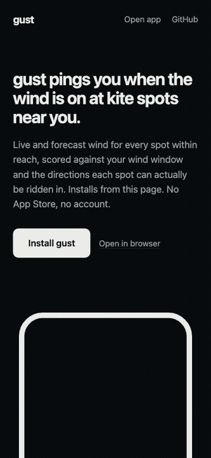

# gust

[](https://github.com/refcell/gust/actions/workflows/ci.yml)
[](https://refcell.github.io/gust/)
[](LICENSE)

Wind alerts for kiteboarding spots near you, installable straight from the web.

https://github.com/refcell/gust/raw/main/assets/demo.mp4

<p align="center"></p>

## Install

Open **https://refcell.github.io/gust/** on your phone.

- **iPhone (iOS 16.4+):** open it in Safari, tap **Install gust**, then follow the sheet: Share, Add to Home Screen, Add. Open gust from the Home Screen and allow location and notifications. Chrome and Edge on iOS 16.4+ can also add to the Home Screen from their share menu. In-app browsers (Instagram, Facebook, TikTok, ...) cannot install; open the page in Safari.
- **Android:** open it in Chrome and tap **Install gust** (or Install app from the browser menu). An APK for sideloading is attached to the [apk-latest release](https://github.com/refcell/gust/releases/tag/apk-latest) ([direct download](https://github.com/refcell/gust/releases/download/apk-latest/app-release-signed.apk)).
- **Desktop:** the landing page shows a QR code that opens the site on your phone. Chrome and Edge can also install it as a desktop app.

No App Store and no account. Settings and saved places stay on the device.

## How it works

1. **Spots.** gust finds kite spots within your search radius (default 50 km) of your current location and of each saved place. It starts from a curated dataset of 680+ spots (about 320 in the US, 75 countries) in [`data/spots.json`](data/spots.json), with depth across the US (CA, OR, WA, HI, TX, NC, FL, MA, the Great Lakes, and more), and adds spots tagged `sport=kitesurfing` on OpenStreetMap through the Overpass API.
2. **Wind.** For every nearby spot it fetches current and hourly `wind_speed_10m`, `wind_gusts_10m` and `wind_direction_10m` from Open-Meteo in one batched request.
3. **Score.** Each spot has rideable direction sectors: the directions that blow onshore, side-onshore or side-shore at that beach. A reading is **Good** when speed is inside your window (default 15–30 kn), gusts are at or below your limit (default 35 kn), and the direction is inside a rideable sector. Wind more than 15° outside every rideable sector is **Offshore**, scores 0, and is never good. Within 15° is marginal and capped at **OK**. Spots with unknown sectors are scored on speed alone and labelled "direction unknown". Scoring lives in [`src/lib/score.ts`](src/lib/score.ts).
4. **Forecast.** Runs of consecutive good hours (default 2 h or longer) in the hourly forecast become "good windows". Cards show "Good until 18:00" or "Next good: Tomorrow 11:00, 4h", and the detail view has a 48-hour chart.
5. **Alerts.** When a watched spot crosses into Good, or a good window starts within the next 24 hours, gust shows a notification.

## Alerts and platform limits

Web apps get fewer background privileges than native apps. gust uses every path each platform allows and tells you in the Alerts tab which ones are active.

| | iPhone (installed PWA) | Android Chrome (installed) | Desktop Chrome/Edge |
|---|---|---|---|
| Check when you open or return to the app | yes | yes | yes |
| Local notification when a spot turns good | yes (iOS 16.4+, installed only) | yes | yes |
| Background checks without a server | no (WebKit has no Periodic Background Sync) | yes, Periodic Background Sync, at the browser's discretion (typically a few times a day) | yes, Periodic Background Sync if installed |
| Background checks with the push server | yes, Web Push (iOS 16.4+) | yes, Web Push | yes, Web Push |
| Location in the background | no | no | no |

- Notifications on iOS only work after installing to the Home Screen and are requested from a button tap, as WebKit requires.
- Phones never give web apps location in the background. Background checks use the last location gust saw while open, plus your saved places. Save the places you ride.
- The push server is optional and self-hosted (see below). The public build enables Web Push only when it is built with `VITE_PUSH_API` set. Without it, iPhone alerts happen when you open the app.

## Data sources

- **Wind:** [Open-Meteo](https://open-meteo.com/) forecast API (CC BY 4.0). No key; the free tier allows fewer than 10,000 calls per day for non-commercial use. gust batches up to 50 spots per request, re-checks only when data is older than 10 minutes, and retries a minute after a failure. Limits are per IP and weighted by the number of locations.
- **Spots:** the curated [`data/spots.json`](data/spots.json) (schema in [`data/README.md`](data/README.md)), plus [OpenStreetMap](https://www.openstreetmap.org/copyright) via Overpass. Overpass is shared infrastructure, so OSM lookups are cached per area for 14 days and capped per device per day. For OSM spots without known sectors, gust infers the shore orientation from nearby `natural=coastline` ways (land on the left, water on the right) and treats ±100° around the seaward normal as rideable.
- **Place search:** Open-Meteo geocoding API.

## Configuration

In the app (Settings tab):

| Setting | Default |
|---|---|
| Units | kn (also mph, m/s, km/h) |
| Wind window | 15–30 kn |
| Max gust | 35 kn |
| Search radius | 50 km |
| Forecast alerts | on, windows of 2 h or longer within 24 h |

Build-time environment variables:

| Variable | Purpose |
|---|---|
| `VITE_PUSH_API` | Base URL of the push backend, e.g. `https://gust-push.example.workers.dev`. Enables Web Push. |
| `VITE_VAPID_PUBLIC_KEY` | VAPID public key (base64url) that matches the backend. |

CI reads both from repository variables (`gh variable set VITE_PUSH_API --body ...`).

Add `?demo=1` to the app URL to use a fixed location in San Francisco with live wind. The landing page embed uses it.

## Development

Requires Node 22+ and pnpm (`corepack enable`).

```sh
pnpm install
pnpm dev          # http://localhost:5173/gust/ (app at /gust/app/)
pnpm test         # unit tests (vitest)
pnpm typecheck
pnpm lint
pnpm build        # dist/, including dist/sw.js
pnpm e2e          # Playwright against `vite preview` (mocked geolocation and network)
node scripts/verify-live.mjs https://refcell.github.io/gust/   # smoke-test a deploy with real data
node scripts/record-demo.mjs   # re-record assets/demo.mp4 and assets/demo.gif (needs ffmpeg)
node scripts/icons.mjs         # regenerate icons from SVG
```

Layout:

```
index.html, src/landing/   landing page (install button, iOS sheet, QR code)
app/index.html, src/app/   the PWA (Preact)
src/lib/                   pure logic: scoring, sectors, units, geo, forecast, alerts, Open-Meteo client
src/sw/sw.ts               service worker: offline shell, data cache, periodic sync, push
data/spots.json            curated spots
server/                    optional Web Push backend (Cloudflare Worker)
android/                   TWA wrapper for the APK
```

Every push to `main` runs typecheck, lint, unit tests, build and e2e, then deploys `dist/` to GitHub Pages.

## Self-hosting the push backend

`server/` is a Cloudflare Worker with KV and a cron trigger. It stores push subscriptions with each subscriber's watched spots and settings, checks the wind every 30 minutes with the same scoring code as the app, and sends Web Push (VAPID) notifications. See [`server/README.md`](server/README.md) for the full steps. In short:

```sh
cd server && pnpm install
npx wrangler login
npx wrangler kv namespace create SUBS     # paste the id into wrangler.toml
node scripts/gen-vapid.mjs                # prints the secret commands and the public key
pnpm run deploy
gh variable set VITE_PUSH_API --body https://<your-worker>.workers.dev
gh variable set VITE_VAPID_PUBLIC_KEY --body <public key>
```

The next CI run builds the app with push enabled.

## License

[MIT](LICENSE)
